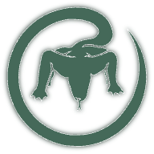

# Komodo Periphery

**Komodo Periphery Agent** connects your Home Assistant server to [Komodo](https://komo.do) for centralized infrastructure management, container deployment, and server monitoring. Note that only the outbound connection mode in periphery is supported - periphery initiates the connection to the Komodo server.

## Privileges

This app requires that **Protection Mode** is off, and takes elevated privileges (**`host-pid`** and **`docker-api`**) to manage Docker containers and monitor system resources. This is necessary for Komodo Periphery to function as a server management agent.

After installation you must disable Protection mode.

## Unsupported system - Unsupported software

If you deploy workloads to your Home Assistant instance through Komodo you **_will_** get an unsupported system warning.

> [!WARNING]
> **Unsupported system - Unsupported software**
>
> System is unsupported because additional software outside the Home Assistant ecosystem has been detected.
> For troubleshooting information, select [Learn more](https://www.home-assistant.io/more-info/unsupported/software).
